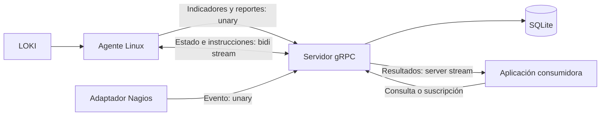
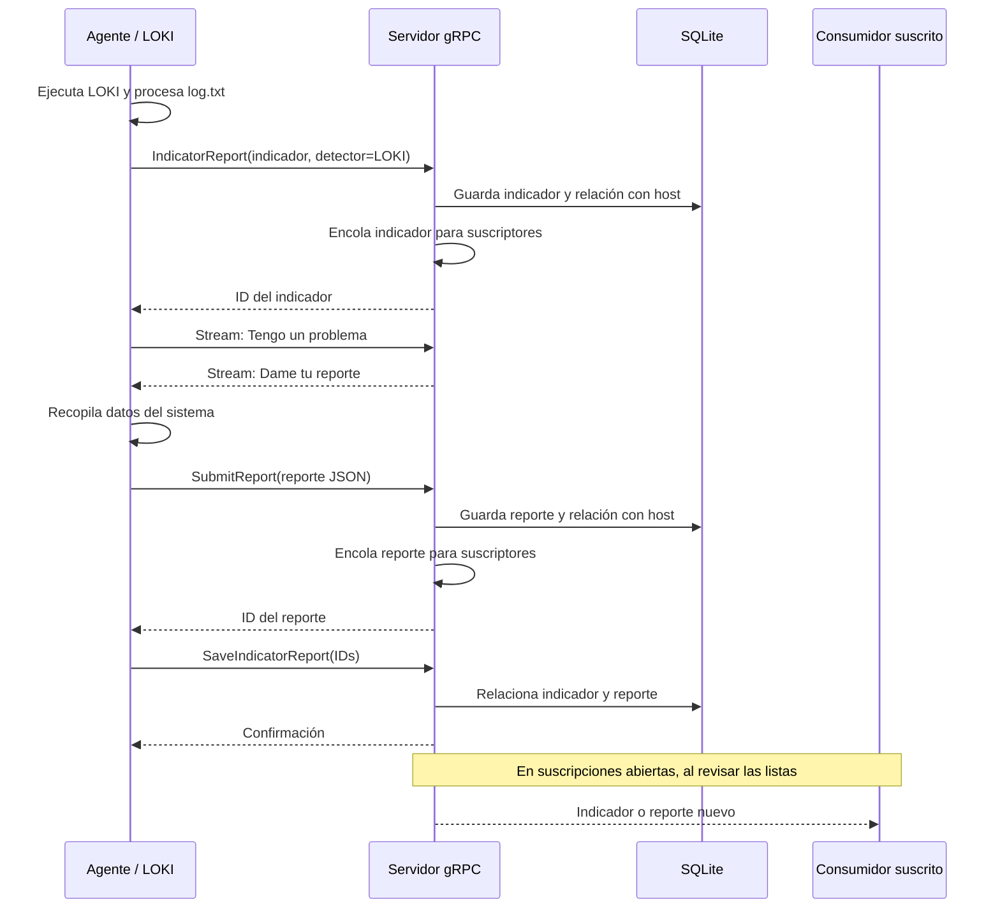

# Arquitectura y flujos

[Volver al proyecto](../README.md) · [Contrato gRPC](../protos/README.md)

## Responsabilidades



El servidor centraliza la coordinación y persistencia. El agente ejecuta comandos del sistema local. `communicationAPI.py` es un consumidor de ejemplo con menú de consola y salida JSON; no es un servidor HTTP.

## Detección local de LOKI



El agente puede acumular varios IDs de indicadores y asociarlos al siguiente reporte. Las notificaciones al consumidor no esperan a que termine esa asociación.

## Solicitud desde Nagios

```text
Nagios detecta un evento
        │
        ▼
communicationNagios.py IP dato1 dato2
        │ IndicatorReport(detector="NAGIOS")
        ▼
Servidor agrega IP a colaReportesNagios
        │
        │ Espera el próximo estado de ese agente
        ▼
Agente recibe "NAGIOS solicita tu reporte"
        │ SubmitReport(... Detector="NAGIOS")
        ▼
Servidor guarda y distribuye el reporte
```

La rama NAGIOS no guarda el evento recibido como indicador ni lo distribuye como tal. La respuesta `Se pediran los reportes` confirma el encolado, no la recepción posterior del reporte.

## Temporización

| Parámetro | Valor | Interpretación actual |
|---|---|---|
| Pausa del generador de estado | 60 segundos | Espera después de producir cada mensaje; las operaciones añaden tiempo. |
| `tiempoLoki` | 120 ciclos | LOKI se lanza al inicio y cada 120 ciclos; aproximadamente dos horas más el tiempo de trabajo. |
| `tiempoReporte` del agente | 20 ciclos | Se espera aproximadamente 20 minutos antes de procesar el log tras lanzar LOKI; no se espera explícitamente a que termine el proceso. |
| Primer reporte global | 5 minutos | Abre la primera ventana de solicitudes tras iniciar el proceso del servidor. |
| `reporteGlobalTiempo` | 240 minutos | Intervalo configurado para siguientes ventanas globales. |
| `tiempoMaximoReporte` | 3 minutos | Duración de la ventana global de solicitudes, no deadline gRPC. |
| Revisión de suscripciones | 10 segundos | Pausa del servidor entre revisiones de las listas. |
| Resultados históricos | 1 segundo | Pausa después de cada mensaje enviado. |

El servidor evalúa la programación global cuando recibe estados. No hay un scheduler independiente. El estado de participación global se conserva por llamada bidireccional, no como registro persistente por host.

## Información del reporte

El JSON de `reporte()` incluye:

- `OpenPorts`, `LastConnections`, `LastConnectionsSSH`.
- `LastUsers`, `Processes`, `AuthLogs`, `SysLogs`.
- `sudoers`, `SUID-SGID`, `Crontabs`.
- `TimeStamp` y `Detector`.

Las salidas son mayormente listas de líneas de comandos Linux. La búsqueda SUID/SGID parte del directorio actual (`find .`), no de todo el sistema. El servidor almacena además su propia fecha y hora de recepción.

## Concurrencia y entrega

- El servidor usa gRPC síncrono con `ThreadPoolExecutor(max_workers=10)`. Los handlers de streams persistentes pueden mantener ocupados esos trabajadores.
- Colas de solicitudes y listas de suscriptores viven en variables globales sin persistencia ni sincronización explícita para operaciones compuestas.
- Una suscripción recibe eventos encolados desde su registro, sin replay histórico automático.
- Se usa `pop()` para enviar pendientes: el orden es LIFO, no cronológico garantizado.
- El mismo nombre de software reutiliza la entrada del diccionario; una nueva suscripción puede reinicializar sus pendientes.
- No se implementan confirmaciones de entrega, limpieza explícita de suscripciones canceladas ni recuperación de streams en los clientes.

## Comprobación MD5

El agente calcula el hash de `communicationClient.py` y llama a `ServerComprobationMD5` antes de abrir el stream de estado. La intención es generar un indicador, pedir un reporte y cerrar la conexión cuando se detecte modificación.

Actualmente `get_hash()` consulta `Hash`, pero devuelve siempre `True`. Por ello la rama de modificación no se activa con esa función. Además, el indicador creado en esa rama no pasa por la misma función de difusión usada por `IndicatorReport`.
